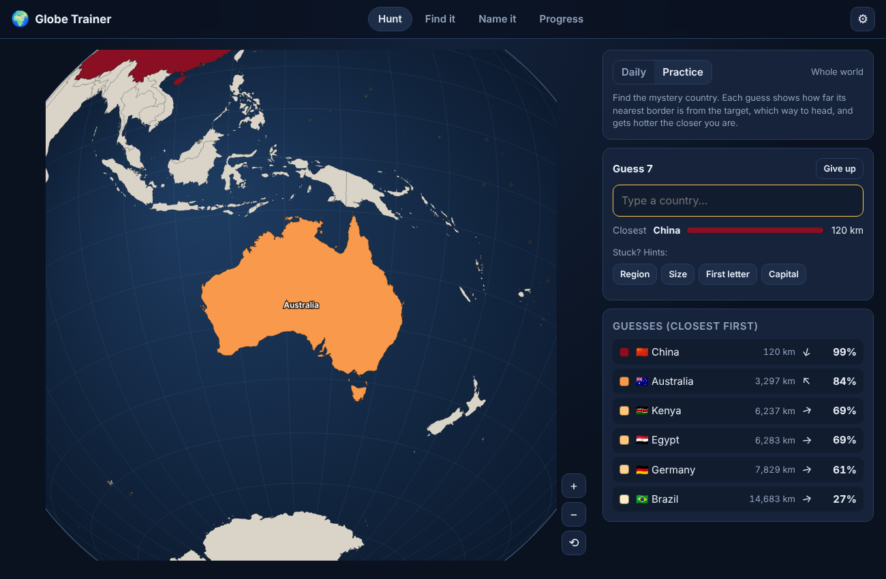
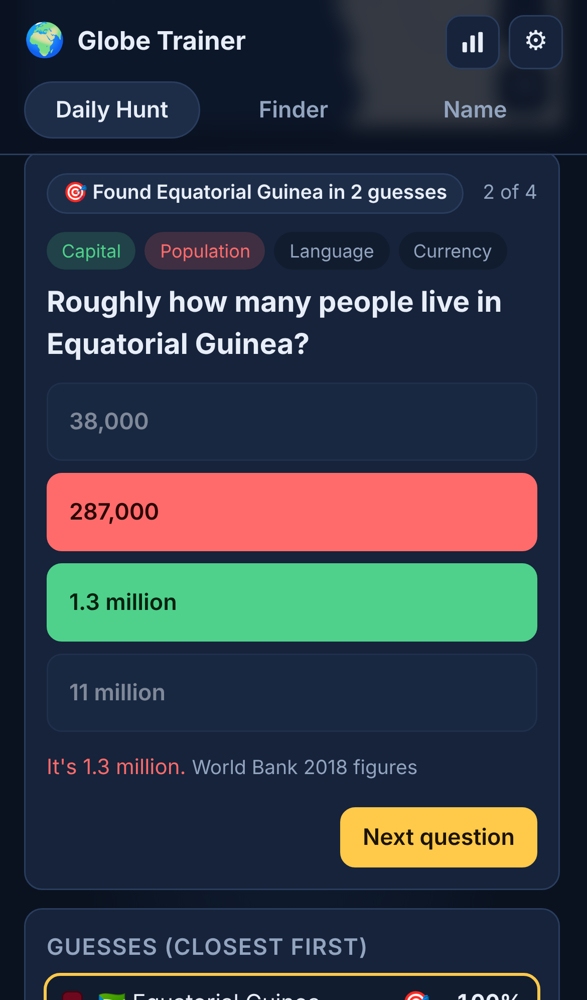

# Globe Trainer

A browser game for learning where every country is. It takes the hot-and-cold country guessing idea and adds the things you need to actually learn: drills, hints, facts after each round, and spaced repetition that brings back the countries you get wrong.





## Modes

**Daily Hunt.** One mystery country a day. New players start here with nothing else on screen; finishing your first daily unlocks Finder, Name, stats and settings.

Each guess is painted on the globe, hotter the closer it is, and listed right under the input (closest first, latest marked) with:
- distance from the nearest border (not centre to centre), so neighbours show as "borders"
- a compass arrow pointing towards the target
- a proximity score

Hints (region, size, first letter) cost 2 each. **Score = guesses + 2 per hint, lower is better.** Your best score and score distribution are in stats.

**Streak:** it grows each day you find the country, however many guesses or hints it takes. Giving up or missing a day resets it to 0. (Finding it with hints still counts because the score already rewards doing it unassisted; the streak is about showing up and finishing.)

Once you find it, a four-question fact quiz: capital, population, language and currency, each multiple choice with nearby countries as the wrong answers. "Copy result" shares your score, streak and quiz result.

**Finder.** You get a country name and tap it on the globe. A miss shows the country you tapped and how far and which way the target is. Three tries, then it's revealed.

**Name.** The globe flies to a highlighted country and you name it. Typed answers by default; switch on multiple choice in settings for an easier version. "Show neighbours" labels the bordering countries as a clue.

**Stats** (chart icon, top right): Daily Hunt record and streak, fact-quiz accuracy by question type, countries mastered per mode, and your weakest countries.

After every round you get a fact card: flag, capital, population, region, area, languages, currency, and clickable neighbours to explore.

Move the globe with gestures: drag to spin, pinch (or scroll on a computer) to zoom.

On phones the country input opens a full-screen picker that sits above the keyboard, with large rows and flags.

## How the training works

Every country has a Leitner box per skill (Find it, Name it, Hunt). Getting it right first time moves it up a box and pushes the next review further out (10 minutes, 1 day, 3 days, a week, 3 weeks). Missing it drops it back to box 1. Practice picks overdue weak countries first, then ones you haven't seen. Progress is saved in your browser's local storage.

## Settings

- Region focus: whole world, Africa, Europe, Asia, Middle East, North and Central America, Caribbean, South America, Oceania
- Include territories and dependencies (Greenland, Puerto Rico, etc.)
- Borders, small-country dots and labels on the globe
- Kilometres or miles

## Play on your phone

The app is deployed to GitHub Pages by `.github/workflows/globe-trainer-pages.yml` on every push to `main` that touches `globe-trainer/`:

**https://awram.github.io/personal-coding/**

Add it to your home screen and it opens full screen like an app and works offline after the first visit:
- **iPhone (Safari):** Share button, then "Add to Home Screen"
- **Android (Chrome):** menu, then "Add to Home screen" or "Install app"

One-time setup in the repo: Settings > Pages > Source: **GitHub Actions**.

## Run it

Requires Node 18+.

```bash
cd globe-trainer
npm install
npm run dev      # local dev server
npm test         # unit tests
npm run build    # static site in dist/, deployable anywhere (relative paths)
```

## Data

Built by `npm run build:data` into `public/data/`:
- Shapes: [world-atlas](https://github.com/topojson/world-atlas) 1:50m (Natural Earth, public domain). Somaliland and Northern Cyprus are merged into Somalia and Cyprus.
- Country facts and alternate names: [world-countries](https://github.com/mledoze/countries) (ODbL).
- Population: World Bank 2018 figures via [country-json](https://github.com/samayo/country-json) (MIT), plus Kosovo and Taiwan added by hand.
- The core pool is the 193 UN members plus Vatican City, Palestine, Kosovo and Taiwan. Tuvalu isn't in the 1:50m shapes, so it's drawn as a dot.

## Code map

| File | What it does |
| --- | --- |
| `src/geo.js` | Distances, bearings, heat colours (pure functions) |
| `src/data.js` | Loads shapes and facts, border-to-border distance with caching, region pools |
| `src/globe.js` | Canvas orthographic globe: drag, zoom, pinch, click to pick, fly-to |
| `src/search.js` | Accent-insensitive name matching and autocomplete |
| `src/progress.js` | Stats, daily puzzle, streaks, spaced repetition |
| `src/quiz.js` | Builds the post-hunt fact quiz |
| `src/stats.js` | Stats dialog |
| `src/modes/*` | Daily Hunt, Finder, Name |
| `scripts/build-data.mjs` | Generates `public/data/` |
